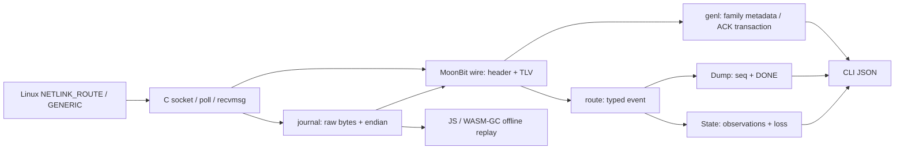

# 架构与协议边界

C 桥只管理系统调用、资源和字节边界，不解析 Netlink 对象。协议、事务、缓存、记录格式和示例都在 MoonBit。核心不依赖 Linux，传输包限制为 native；项目没有第三方 Mooncakes 依赖。

输入先检查长度再读取字段；报文和属性按四字节对齐，最后一项允许没有尾部 padding。长度溢出、短固定头、错误属性、无效字符串和控制消息错误都产生明确失败。端序由调用方指定，嵌套和 network-byte-order 标志独立处理，未知对象/属性保留。

原生接收先探测整份 datagram 大小，再接收；检查 kernel sender、截断和尺寸预算。ENOBUFS、EMSGSIZE 作为丢失记录并使 watch 失效。socket 使用 CLOEXEC/NONBLOCK，poll 有截止时间和 EINTR 重试，借用 FFI 参数并由外部对象 finalizer 释放 fd。

dump 按 seq 匹配，只有成功 DONE 才交付结果。没有 DONE、DUMP_INTR、负 errno、overrun 都不能伪装成成功。四种 dump 顺序执行，所以只保证每类事务完成，不保证跨类原子性。

State 将 link 按 index、address 按接口/族/前缀/地址、neighbor 按接口/族/目的地址维护；link 删除清理依赖对象。route 按完整可观察身份维护，保留多路径原始属性。这不涵盖内核的所有替换和通配删除规则。失效标记保持到调用方重新建立状态；初始缓存始终部分覆盖。MVP 不提供无竞态 snapshot+subscribe 初始化。

真实 Linux fixture 与明确标注的合成失效场景分开。两者在 JS/WASM-GC 使用同一协议代码；真实采集还在 Linux 原生端独立重放。验证路径可区分协议正确性、传输正确性和缓存适用边界。
